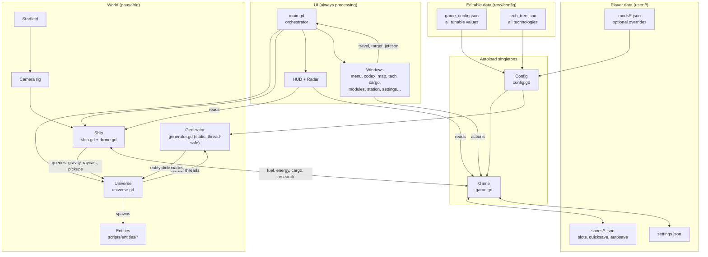
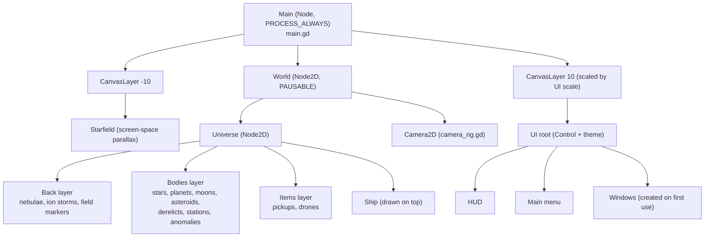
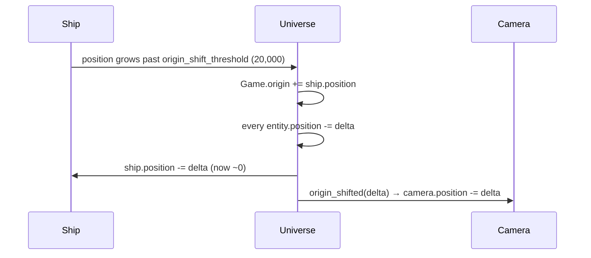
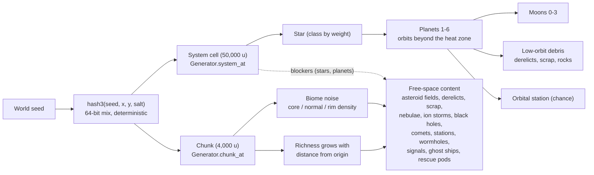
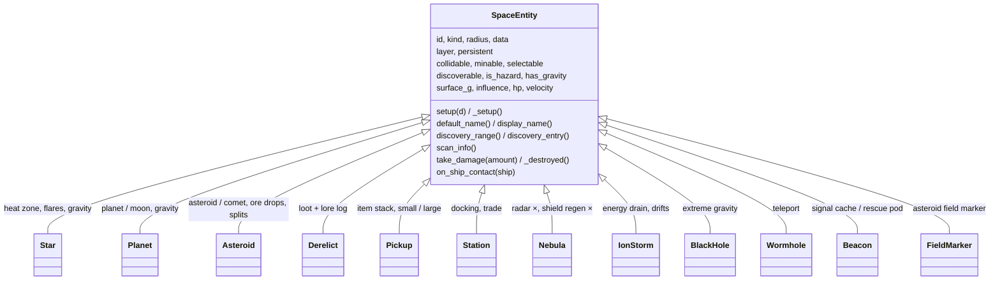
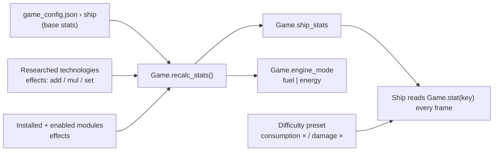
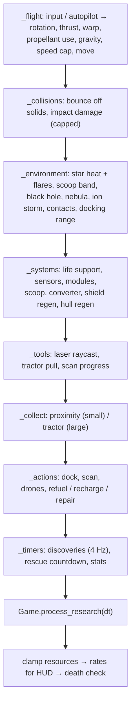
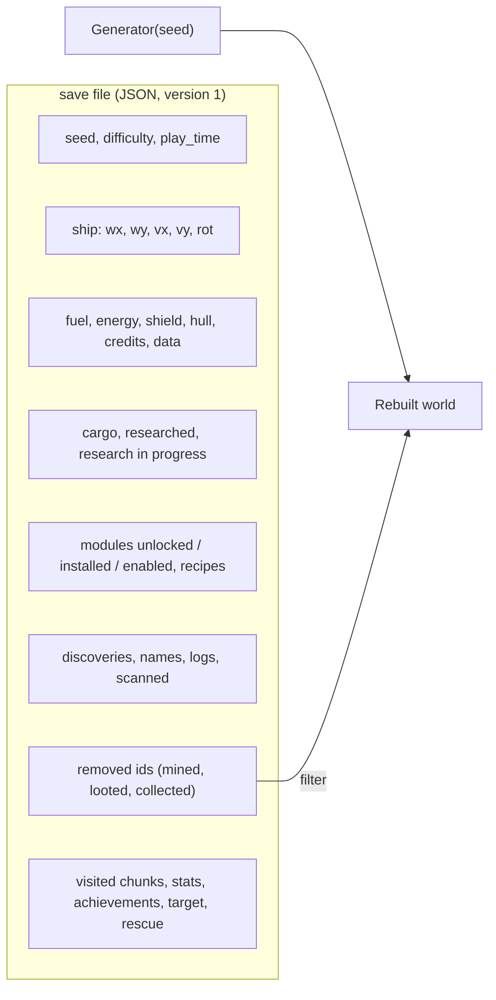

# Architecture

Space Scavenger is a Godot 4.7 project written only in GDScript. Except for `scenes/main.tscn` (one root node) and the test scene, every node is built in code. All art is drawn with `_draw()` vector shapes, so the project has no image or audio assets.

## 1. Big picture



| Layer | Responsibility | Key files |
|---|---|---|
| **Config** | Loads the two JSON files, merges mod overrides, builds the `InputMap` from `input_bindings`, provides typed accessors (`fval`, `ival`, `dict`, `item`). | `scripts/autoload/config.gd` |
| **Game state** | Holds everything that persists: resources, cargo, credits, research, modules, discoveries, names, delta removals, statistics, achievements, target and settings. Computes ship stats. Saves and loads. | `scripts/autoload/game.gd` |
| **Generation** | Pure functions: `seed + coordinates → entity dictionaries`. No nodes, so they are safe to run on worker threads. | `scripts/world/generator.gd`, `naming.gd` |
| **Universe** | Streams chunks and star systems, owns entity nodes, keeps the floating origin, and answers spatial queries (gravity, raycast, entity at point). | `scripts/world/universe.gd` |
| **Entities** | One script per kind. Each draws itself and exposes flags (collidable, minable, discoverable…) plus hooks (`scan_info`, `_destroyed`, `on_ship_contact`). | `scripts/entities/*.gd` |
| **Ship** | Flight physics, autopilot, warp, laser, tractor, collection, scanning, drones, docking, environment damage, energy systems, quick travel, death. | `scripts/ship/ship.gd`, `drone.gd` |
| **UI** | HUD, radar, menus and modal windows, all built in code from `UiKit` helpers and one shared theme. | `scripts/ui/*.gd` |
| **Orchestrator** | Builds and destroys the world, routes input, opens windows (pausing the game), queues naming prompts, autosaves, and handles death and reload. Also contains the `--autotest` session. | `scripts/main.gd` |

## 2. Runtime scene tree



Opening any window calls `get_tree().paused = true`. The world is `PAUSABLE`, so it freezes. The UI, the camera (for photo mode) and `main.gd` keep processing.

## 3. Coordinates and the floating origin

32-bit float positions lose precision far from (0, 0). The game separates **world** coordinates from **node** coordinates:

```
world (64-bit float) = Game.origin + node.position (32-bit, always small)
```



* Generator output, saves, discoveries and targets always use world coordinates (`wx`, `wy`).
* `Universe.to_local_pos(wx, wy)` and `world_x/world_y(pos)` convert between the two.
* `Universe.teleport(wx, wy)` (wormholes, quick travel, loading) clears every entity, sets the origin to the destination and streams fresh content around it.

## 4. Procedural generation



* **Deterministic:** every random choice comes from a `RandomNumberGenerator` seeded with `hash3(seed, x, y, salt)`. The same seed always produces the same universe, so seeds can be shared.
* **Exclusion:** chunk content avoids star heat zones and planets in nearby systems, and avoids a safe radius around the start position.
* **Home content:** system cell (0, 0) always has a G-class star with 3 planets. Chunk (0, 0) always contains the *Haven Prime* station, and chunk (0, −1) contains a starter derelict.
* **Stable ids:** each entity id encodes where it came from (`c3_-2_a7`, `s0_0_p1_m0`…). This is what makes delta saves possible.

## 5. Chunk streaming (threading)

```mermaid
sequenceDiagram
  participant Main as Main thread (Universe._process)
  participant Pool as WorkerThreadPool
  participant Gen as Generator
  Main->>Main: compute ship chunk (cx, cy) and system cells
  loop each missing chunk within load_radius_chunks
    Main->>Pool: add_task(_generate_task, key, seed)
    Pool->>Gen: chunk_at / system_at
    Gen-->>Pool: Array of entity dictionaries
    Pool-->>Main: push to _results (mutex)
  end
  Main->>Main: _collect_results → skip ids in Game.removed → spawn queue
  Main->>Main: spawn ≤ max_spawns_per_frame nodes per frame
  Main->>Main: free chunks beyond unload_radius_chunks and transients beyond transient_unload_distance
```



* Loading 5×5 chunks around the ship keeps about 150–300 entities alive. The autotest held ~60 FPS while warping at full speed.
* Results that arrive for a chunk that was unloaded or teleported away in the meantime are discarded (`_pending` check), and results from an old seed are ignored.

## 6. Entity model



The Universe indexes entities by role: `pickups`, `solids` (collidable), `gravity_sources` and `hazards`. Each frame the ship walks only the index it needs.

## 7. Ship stats pipeline



`recalc_stats()` runs on research completion, module install/uninstall/toggle, load and config reload. Resources are clamped to the new capacities.

## 8. Ship frame update order



## 9. Persistence (delta saves)



* The universe itself is never saved. It is regenerated from the seed, and anything in `removed` is skipped.
* Transient objects (salvage drops, asteroid fragments, jettisoned cargo) are not saved. See TODO-22.
* `Game.migrate()` upgrades older save versions. `SAVE_VERSION` is currently 1.
* Slots are `slot_1..5`, `quicksave` and `autosave`. Ironman runs keep a single `ironman_<seed>` slot.
* Autosave runs every `autosave.interval_sec`, but only when the hull is above `min_hull_fraction`, the ship has taken no damage for `quiet_time_sec`, and there is no heat. It also saves on docking and on a new game.

## 10. UI composition

* `UiKit` builds the shared `Theme` and small widgets (labels, buttons, bars, scroll areas).
* `WindowPanel` is the modal base class: a dim backdrop, a centred titled panel, `_build()` once, `refresh()` on every open, and Esc closes it.
* Window classes live in `simple_windows.gd` (pause, save/load, settings, help, naming, message, statistics), `game_windows.gd` (codex, tech, cargo, modules, station) and `map_window.gd`.
* UI scale is applied by scaling the UI `CanvasLayer`. The root control is resized to `viewport / scale` every frame.
* Two palettes (normal and colour-blind safe) are defined in config. `Game.pal(key)` returns the active colour, and the radar also encodes kind by shape.

## 11. Extension points

| To add… | Do this |
|---|---|
| A tunable number | Add it to `game_config.json` and read it with `Config.fval("section.key")`. |
| A technology | Add a node to `tech_tree.json`. No code is needed if it uses existing stats, modules or recipes. |
| An item, recipe or module | Add it to `items` / `recipes` / `modules` in `game_config.json`. Unlock it from a tech node if it should not be available at the start. |
| A new ship stat | Add it to `ship` in the config, then read it with `Game.stat("name")` where it applies. Techs and modules can then modify it. |
| A new entity kind | Create `scripts/entities/<kind>.gd` extending `SpaceEntity`, register it in `Universe.SCRIPTS`, emit it from `Generator.chunk_at`/`system_at`, and add a `radar_colors` entry and `discovery` values. |
| A new window | Subclass `WindowPanel`, then add it to `main._window()` and, if it has a hotkey, to `WINDOW_KEYS` plus `input_bindings`. |
