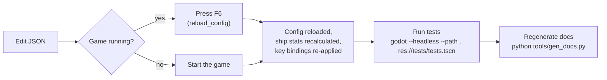

# Configuration & Tuning Guide

Two files control everything that can be balanced. Neither needs code changes.

| File | What it controls |
|---|---|
| [`config/game_config.json`](../config/game_config.json) | Every limit, rate, price, cost, spawn chance, item, loot table, recipe, module, difficulty preset, warning threshold, achievement, colour palette and key binding. |
| [`config/tech_tree.json`](../config/tech_tree.json) | Every technology node: branch, tier, cost, research time, prerequisites, effects and unlocks. |

The current values in table form are in [CONFIG_REFERENCE.md](CONFIG_REFERENCE.md) and [TECH_TREE.md](TECH_TREE.md). Both are generated by `python tools/gen_docs.py`.

## 1. Editing workflow



* **JSON rules:** no comments and no trailing commas. Keys that start with `_` (such as `_readme`) are ignored notes. If a file fails to parse, the main menu shows the error with its line number, and so does the F6 toast.
* **What F6 reloads immediately:** ship stats, item, recipe and module definitions, prices, warnings, palettes and key bindings.
* **What applies only to new content:** world generation values (`world`, `bodies`, `asteroids`, `derelicts`, `hazards`) affect chunks generated after the change. Fly away or reload the save to see them.
* **Validation:** the test suite checks that every tech prerequisite, cost item, unlocked module or recipe, effect stat and loot item exists. Run it after every edit.
* **Exported builds:** a `config/` folder placed next to the executable overrides the packaged files, so testers can tune without re-exporting.
* **Mods / personal overrides:** files in `user://mods/` are deep-merged on top. On Windows that folder is `%APPDATA%\Godot\app_userdata\Space Scavenger\mods\`.
  * `game_config.json` override: include only the keys you want to change, e.g. `{"ship": {"thrust": 400}}`.
  * `tech_tree.json` override: nodes and branches are matched by `id`. A matching id replaces the node, and a new id is added.

## 2. `game_config.json` sections

| Section | Purpose | Most useful keys |
|---|---|---|
| `world` | Streaming and generation layout | `chunk_size`, `load_radius_chunks`, `system_cell_size`, `system_chance`, `spawn.*` chances, `biome.density`, `richness_per_100k`, `home_system`, `home_station` |
| `bodies` | Star classes, planet types, moons | `star_types.<class>.radius / heat_factor / surface_gravity / weight`, `planet_types.*`, `*_influence_factor` |
| `heat` | Star heat and flares | `max_damage_per_sec`, `scoop_radius_factor`, `flare_interval`, `flare_heat_multiplier` |
| `hazards` | Nebula, ion storm, black hole, comet | `nebula.radar_multiplier`, `ion_storm.energy_drain_per_sec`, `black_hole.surface_gravity / damage_per_sec` |
| `anomalies` | Wormholes, signals, rescue pods | `wormhole.jump_distance`, `signal.credits`, `rescue.time_limit / credits` |
| `asteroids` / `derelicts` | Size, HP, ore mix, loot table | `hp_per_radius`, `ore_weights`, `split_min_radius`, `derelicts.<type>.hp / loot` |
| `ship` | **Base ship stats** (see below) | thrust, fuel, energy, cargo, tools, ranges, quick travel, collisions |
| `drones` | Collector drones | `speed`, `range`, `energy_per_sec`, `duration` |
| `warnings` | Low-resource banner | `fuel_low`, `energy_low`, `hull_low`, `critical`, `suggest_kinds` |
| `discovery` | Discovery ranges and data value | `range.<kind>`, `data_value.<kind>`, `discovery_data_fraction` |
| `items` | Every item | `weight`, `volume`, `price`, `size` (small/large), `use.restore / amount` |
| `loot` | Drop tables | per entry `item`, `min`, `max`, `chance` |
| `recipes` | Crafting | `inputs`, `outputs`, `module`, `starting` |
| `modules` | Ship modules | `energy_per_sec`, `effects`, `starting` |
| `starting_modules`, `start.cargo` | New-game loadout | module ids, item counts |
| `station` | Economy | `sell_multiplier`, `buy_multiplier`, `buy_items`, service prices, `data_price_per_point` |
| `difficulty` | Presets | `consumption_multiplier`, `damage_multiplier`, `permadeath`, `start_credits` |
| `autosave` | Autosave policy | `interval_sec`, `min_hull_fraction`, `quiet_time_sec` |
| `camera` | Zoom and follow feel | `zoom_min/max/default`, `zoom_step`, `lookahead_factor`, `lookahead_max` |
| `achievements` | Goals | `stat`, `threshold` |
| `naming`, `lore` | Name lists and log templates | catalogues, constellations, Greek letters, log `templates` |
| `input_bindings` | Keys, mouse, gamepad | action → list of bindings |
| `palette`, `radar_colors` | Colours | `normal` / `colorblind` HUD palettes, per-kind radar colours |

### Ship stats reference (`ship`)

These are the base values. Technologies and modules modify them through `effects`.

| Group | Keys | Notes |
|---|---|---|
| Flight | `thrust`, `retro_factor`, `rcs_thrust`, `rotation_speed`, `max_speed`, `overspeed_decay` | Acceleration in units/s². Above `max_speed` the velocity decays back smoothly. |
| Warp | `warp_max_speed`, `warp_thrust_multiplier`, `warp_fuel_burn_per_sec` | Warp burns fuel continuously while held. |
| Fuel | `fuel_capacity`, `fuel_burn_per_sec`, `ion_cost_factor` | `ion_cost_factor` converts fuel use into energy use once the Ion Drive is researched. |
| Energy | `energy_capacity`, `life_support_drain`, `sensor_drain`, `rcs_energy_per_sec`, `life_support_failure_damage` | Hull damage per second when energy reaches 0. |
| Shields / hull | `shield_max`, `shield_regen_per_sec`, `shield_regen_energy_per_point`, `shield_regen_delay`, `hull_max`, `hull_regen_per_sec` | |
| Cargo | `cargo_max_weight`, `cargo_max_volume` | Both limits apply (G6). |
| Tools | `tractor_range`, `tractor_strength`, `tractor_energy_per_sec`, `proximity_range`, `collect_radius`, `laser_range`, `laser_dps`, `laser_energy_per_sec`, `salvage_yield` | Keep `proximity_range` < `tractor_range` so the tractor stays useful (G10). |
| Sensors | `radar_range`, `scan_range`, `scan_energy`, `scan_time` | |
| Power modules | `scoop_rate`, `converter_rate`, `converter_ratio`, `heat_resistance` (0..0.95) | Usually 0 at base; raised by modules and techs. |
| Slots / drones | `module_slots`, `drone_count` | |
| Quick travel | `quick_travel_max_distance`, `quick_travel_fuel_per_1000`, `quick_travel_energy` | G4: costs resources, limited range. |
| Collisions | `collision_safe_speed`, `collision_damage_factor`, `collision_max_damage`, `collision_restitution` | Damage = (impact speed − safe speed) × factor, capped per hit. |
| Navigation | `gravity_assist_efficiency`, `dock_range`, `dock_max_speed`, `autopilot_arrive_margin` | |

## 3. `tech_tree.json` format

```json
{
  "id": "eng_warp_coils",
  "branch": "engines",
  "tier": 2,
  "name": "Warp Coils",
  "description": "Faster and more efficient warp.",
  "cost": { "titanium_plate": 3, "electronics": 4 },
  "time": 120,
  "requires": ["eng_thrusters_1"],
  "effects": [
    { "stat": "warp_max_speed", "op": "mul", "value": 1.35 },
    { "stat": "warp_fuel_burn_per_sec", "op": "mul", "value": 0.8 }
  ],
  "unlocks": { "modules": [], "recipes": [] },
  "sets": { "engine_mode": "energy" }
}
```

| Field | Meaning |
|---|---|
| `id` | Unique key. Saves store researched ids, so avoid renaming ids that players may already have. |
| `branch` | Must match an id in `branches` (it decides the column in the Tech window). |
| `tier` | Display order inside the branch. |
| `cost` | Items consumed when research starts (item ids from `items`). |
| `time` | Seconds of game time with the Lab enabled. |
| `requires` | Node ids that must be researched first. |
| `effects` | Changes to any key in `ship`: `add`, `mul` or `set`. Effects stack in research order. |
| `unlocks.modules` / `unlocks.recipes` | Makes modules installable or recipes craftable. |
| `sets.engine_mode` | `fuel` or `energy` (Ion Drive). |

## 4. Common tuning recipes

| Goal | Change |
|---|---|
| Game feels too punishing | Lower `difficulty.standard.consumption_multiplier` / `damage_multiplier`; raise `warnings.*_low` so warnings come earlier; raise `start.cargo.fuel_cell`. |
| Travel feels slow | Raise `ship.max_speed` and `ship.thrust`; raise `warp_max_speed`; lower `world.system_cell_size` so systems are closer. |
| Fuel runs out too quickly | Lower `ship.fuel_burn_per_sec` / `warp_fuel_burn_per_sec`; raise `items.fuel_cell.use.amount`; add more fuel cells to the `loot.derelict_*` tables. |
| Space feels empty | Raise `world.spawn.*_chance` (asteroid fields, derelicts, scrap) or `world.biome.density.*`. |
| Mining is tedious | Raise `ship.laser_dps` or lower `asteroids.hp_per_radius`. |
| Cargo fills too fast | Raise `ship.cargo_max_weight` / `cargo_max_volume`; lower item `weight` / `volume`. |
| Research is too slow or too cheap | Scale `time` and `cost` in `tech_tree.json`. The Tech Tree doc shows the totals. |
| Stars are too deadly | Lower `heat.max_damage_per_sec` or each class's `heat_factor`; lower `flare_heat_multiplier`. |
| Economy too generous | Lower `station.sell_multiplier` / `data_price_per_point`; raise `buy_multiplier`. |
| Warp crashes too lethal | Lower `ship.collision_max_damage`; raise `collision_safe_speed`. |
| Rebind a key | Edit `input_bindings.<action>`, e.g. `"laser": ["Space", "MouseMiddle"]` (avoid keys already used by another action). |

## 5. Settings stored per player (not balancing)

`user://settings.json` holds UI scale, colour-blind palette, game speed, "ask to name discoveries", control hints and fullscreen. Players change these in **Settings**; they are not part of the tuning files.
