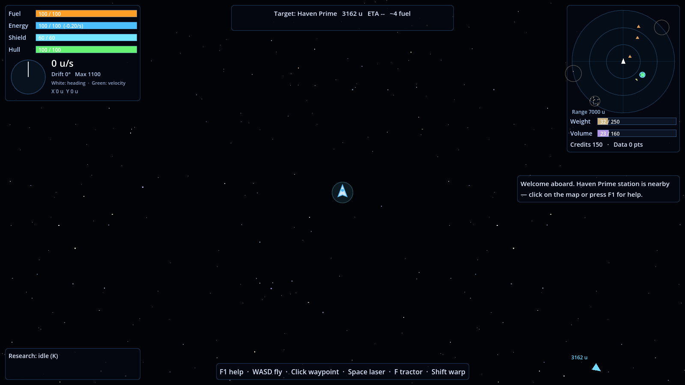
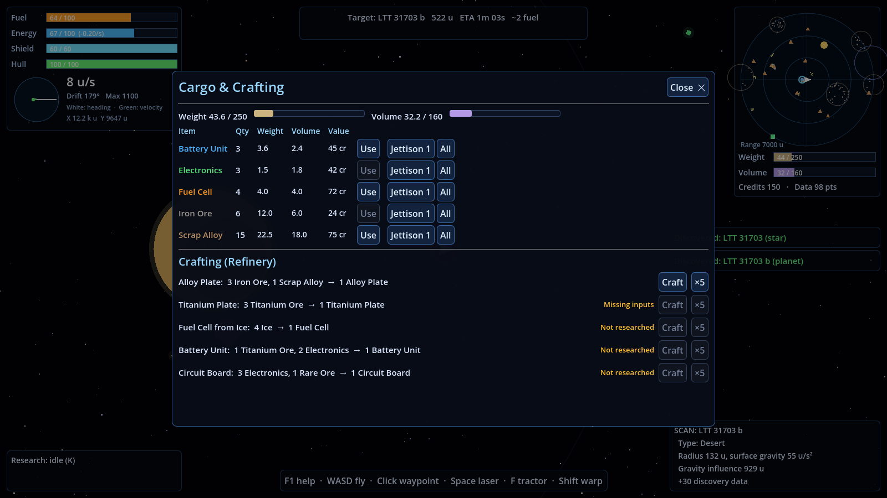
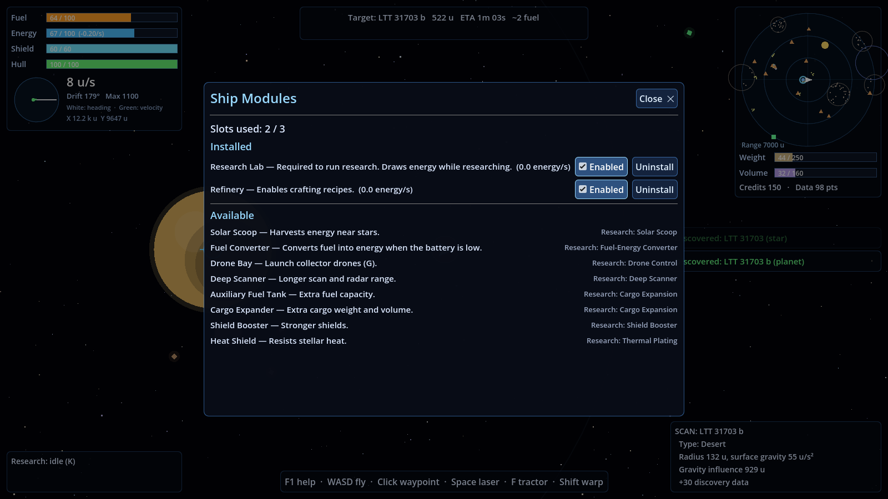
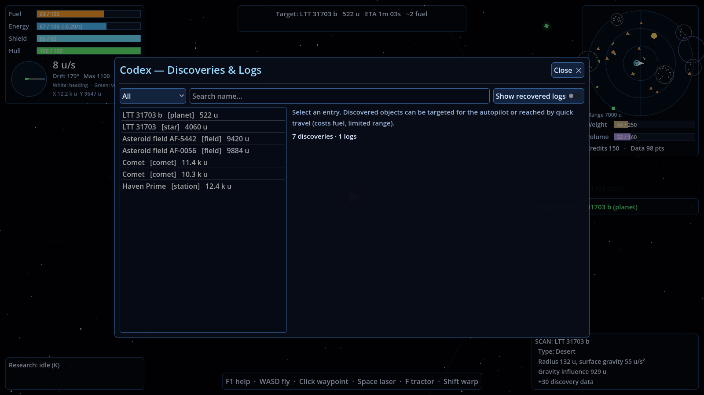

# Player Guide

You command a lone scavenger vessel in an endless universe. Travel burns **fuel**, everything else runs on **energy**, and the hull will not survive careless flying. Salvage what others left behind, research better technology, and push farther out.

## The HUD

| Area | Shows |
|---|---|
| Top left | **Fuel, Energy, Shield, Hull** gauges with the current rate per second. Below them, the vector display: the white line is your heading, the green arrow is your actual velocity. "Drift" is the angle between them. Also speed, top speed and world coordinates. |
| Top centre | Current **target**: distance, ETA, estimated fuel, autopilot state. Underneath are status flags (WARP, NEBULA, HEAT, SCOOPING, SENSORS OFFLINE…). |
| Below that | **Warning banner** when fuel, energy or hull run low, with the nearest place to get help (press **T** to set course). |
| Top right | **Radar** (north up): large dots for stars, dots for planets and moons, squares for stations, triangles for derelicts, rings for fields and hazards, diamonds for anomalies, and a ring for your target. Below it are cargo weight and volume, credits and discovery data. |
| Right | Notifications. |
| Bottom left | Research progress and rescue countdown. |
| Bottom centre | Context hint (e.g. "Press X to dock"). |
| Bottom right | Results of the last scan. |

## Flying

* **W** thrusts forward, **S** fires retro thrusters, **A/D** rotate, **Q/E** strafe. Space has no friction: to stop, you must thrust against your motion.
* Planets, moons and stars pull on you. Ships that skim gravity wells save fuel once **Gravity Assist Computer** is researched.
* **Left-click** anywhere to set a waypoint, or click an object to target it. The **autopilot** flies there, steers around stars and planets, and brakes. Any manual input takes over.
* **Hold Shift** to **warp**: very fast and very thirsty, with the laser and tractor disabled. Never warp through asteroid fields.
* **Quick travel** (Codex **C** or Map **Tab**) jumps to a discovered object within range for a fuel cost that grows with distance.
* With no propellant you only have weak RCS thrusters. Carry fuel cells (**R** uses one).

## Scavenging

| Action | How |
|---|---|
| Cut asteroids and derelicts | Hold **Space**; the laser aims at the mouse. Large rocks split into fragments. |
| Pick up small drops (ore, scrap, electronics) | Fly close; proximity collection does it automatically. |
| Pick up large drops (fuel cells, batteries, plates, data cores) | Hold **F** (tractor beam, short range). |
| Let drones do it | **G** with a Drone Bay module installed. |
| Learn what something holds | **V** scans the target, the object under the mouse, or the nearest object. The first scan of each object earns discovery data. |

Cargo has **two limits**, weight and volume. When either is full, jettison (Cargo window **I**), craft raw materials into denser goods, or sell at a station.

## Survival checklist

* **Stars:** the dashed red ring marks the thermal zone. Damage rises sharply as you approach the surface. Solar flares triple the heat, and you get a warning first.
* **Energy at zero:** sensors go offline, shields stop recharging and life support starts damaging the hull.
* **Repairs:** **H** uses scrap alloy or plates from cargo; stations repair fully for credits.
* **Shields** absorb impacts and heat first, then recharge after a short delay using energy. Nebulae recharge them faster.
* **Warnings** appear at 35% hull, 25% fuel and 20% energy. Press **T** to head to the suggested help.

## Stations

Slow down inside the green docking ring and press **X**. Docking saves your game automatically.

Stations sell fuel, energy and repairs. They buy your cargo and **discovery data** (earned by discovering and scanning), and sell essential supplies.

## Crafting, modules and research

* **Cargo & Crafting (I):** refinery recipes such as Alloy Plate (3 iron + 1 scrap) and Titanium Plate. More recipes are unlocked by research.
* **Modules (U):** install modules into limited slots and toggle them on or off. The **Research Lab** must stay enabled for research to progress.
* **Technology Tree (K):** six branches (Engines, Fuel & Power, Hull & Shields, Electronics, Salvage, Cargo). Research costs resources up front and then takes time. Late technologies include the **Ion Drive**, which runs the engines on energy, and **Quantum Warp**. Full list: [TECH_TREE.md](TECH_TREE.md).

| Cargo & crafting | Modules |
|---|---|
|  |  |

## Exploration and the codex

Every star, planet, moon, station, nebula, black hole, wormhole, asteroid field and anomaly you come near is added to the **Codex (C)**. There you can filter, read scan data, rename bodies, set targets and quick-travel. When you discover a star, planet or moon you can name it, or keep its catalogue designation (HD 40307, Tau Ceti b, Tau Ceti b II…). Recovered derelict logs are also in the Codex.

The **Galaxy Map (Tab)** shows explored sectors, all discoveries, your quick-travel range and your course.

| Codex | Scan result |
|---|---|
|  |  |

## Difficulty

| Preset | Consumption | Damage | On destruction |
|---|---|---|---|
| Relaxed | ×0.6 | ×0.5 | Reload last save |
| Standard | ×1.0 | ×1.0 | Reload last save |
| Ironman | ×1.15 | ×1.25 | Run over; the single save is deleted |

## Saving

* **F5** quicksave, **F9** quickload, or use the five slots in the pause menu (**Esc**).
* Autosave runs every 2 minutes when it is safe, and on every docking.
* Ironman runs have one save that the game writes for you.

## Controls

The full list is in game (**F1**) and in the [README](../README.md#controls-default). Bindings can be changed in `config/game_config.json` → `input_bindings`.
