# Game Flow

## 1. Application states

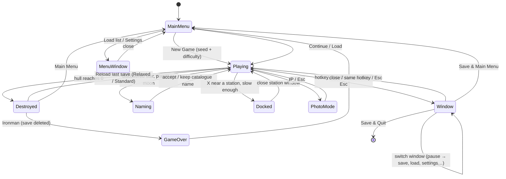

Every state except **Playing** pauses the world simulation. Research and timers only advance in **Playing**.

| Main menu | In flight |
|---|---|
|  |  |

## 2. Core gameplay loop

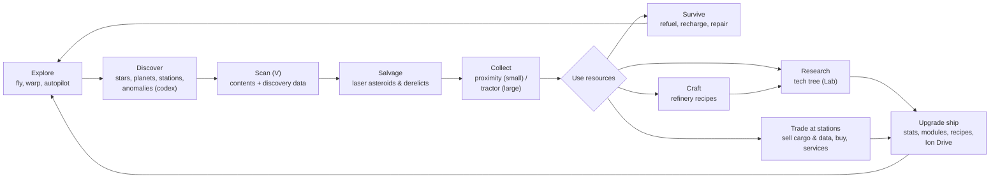

## 3. Resource economy

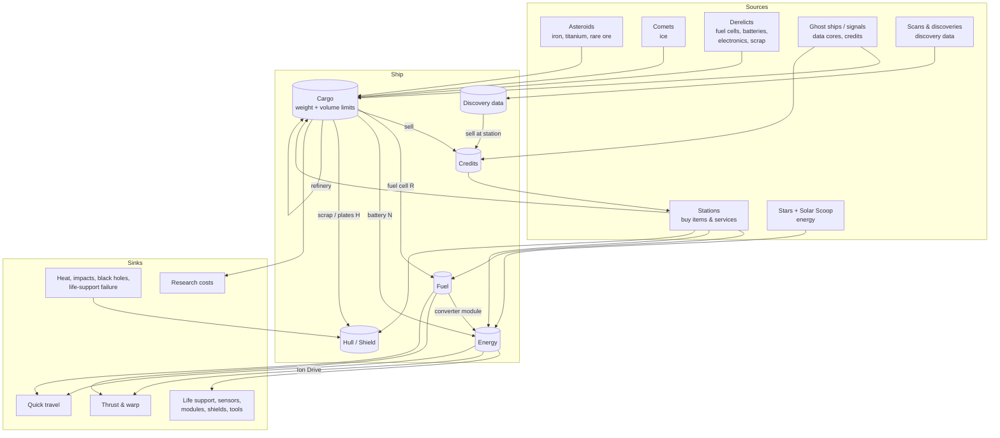

## 4. Navigation options

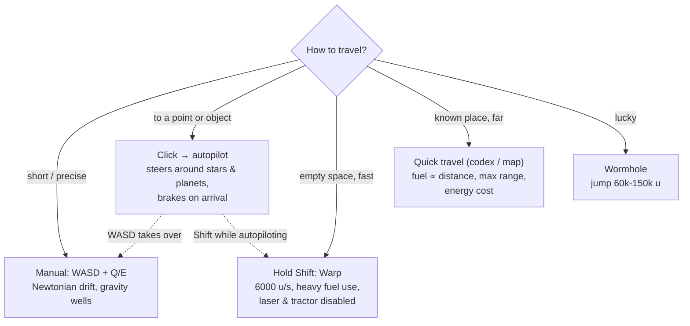

| Autopilot to a station | Galaxy map with quick-travel range |
|---|---|
|  |  |

**Out of propellant:** main engines stop and only weak RCS thrusters remain (`ship.rcs_thrust`). The distress beacon is deferred (TODO-05).

## 5. Discovery and naming

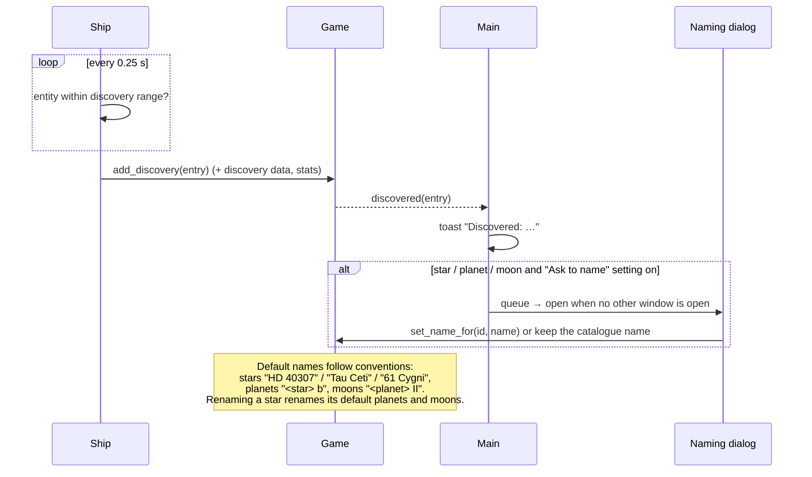

Discovered objects appear in the **Codex** (C) and on the **Galaxy Map** (Tab), where they can be targeted, renamed or used as quick-travel destinations.

## 6. Salvage and collection

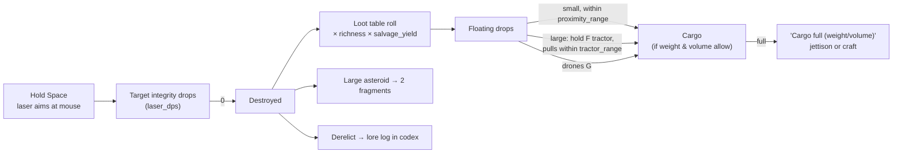

| Laser in action | Drops after salvage |
|---|---|
|  | 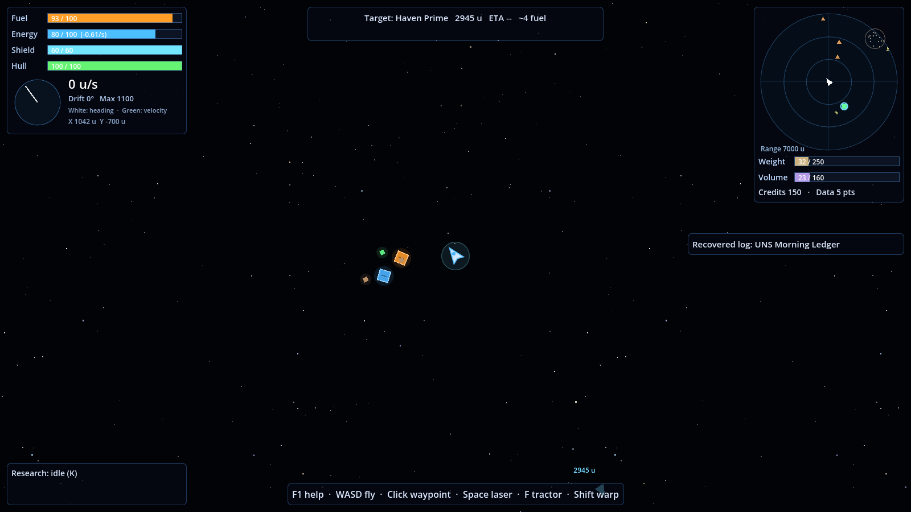 |

## 7. Survival and warnings

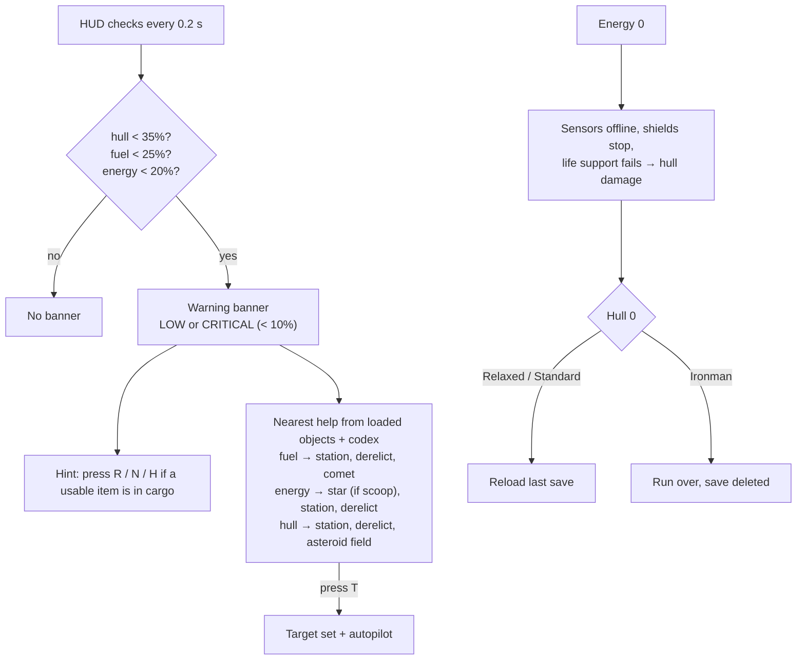

| Low fuel suggestion | Destroyed |
|---|---|
|  | 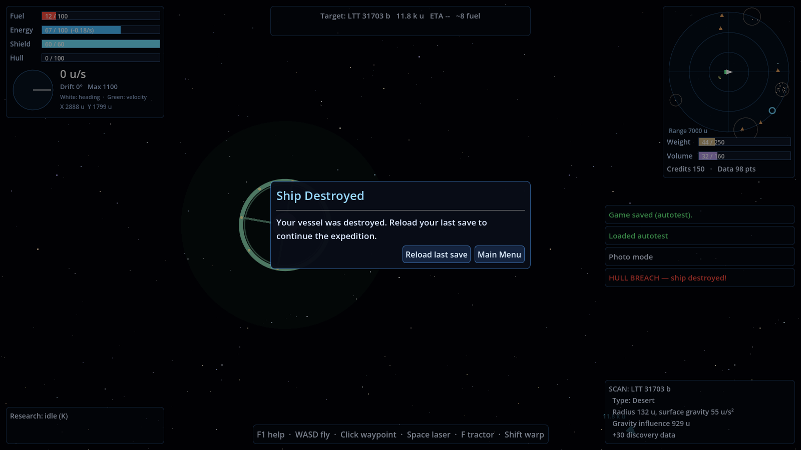 |

Thresholds and suggestion kinds are in `warnings` in `game_config.json`. The fail state is the implemented default and is still awaiting confirmation (TODO-T07).

## 8. Research

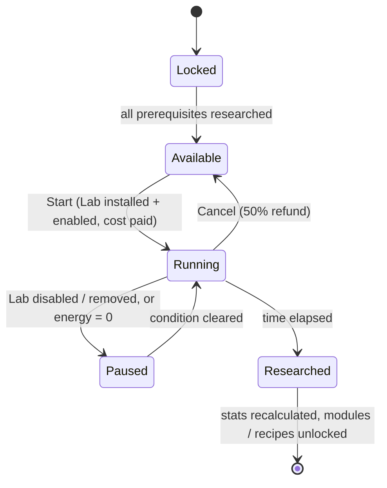

Only one technology can be researched at a time. See [TECH_TREE.md](TECH_TREE.md).

## 9. Docking and trade

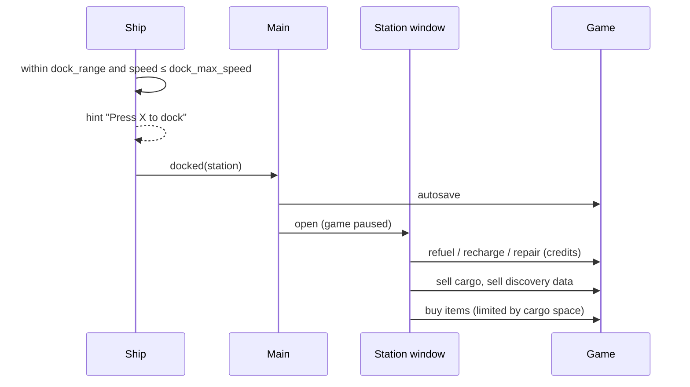

## 10. Hazards and anomalies at a glance

| Object | Effect | Counter-play |
|---|---|---|
| Star heat zone (dashed red ring) | Damage grows quadratically toward the surface; flares ×3 with a warning | Keep out; Thermal Plating, Heat Shield module |
| Solar flare | Temporary heat spike | Leave when warned |
| Planet / moon gravity | Pulls the ship; collisions hurt | Gravity Assist tech makes thrust deep in wells cheaper |
| Black hole | Huge gravity, heavy damage near the horizon | Autopilot avoids it; keep away |
| Nebula | Radar range ×0.35, shield regen ×2.5 | Recharge shields, navigate carefully |
| Ion storm (drifts) | Drains energy | Go around |
| Asteroid field | Collisions; mining target | Slow down; never warp through it |
| Wormhole | Jumps 60k–150k units | Free long-distance travel |
| Unknown signal | Credits and supply cache | Fly into it |
| Escape pod | Timed rescue (120 s) for a reward | Reach it in time |
| Ghost ship | Rich derelict with data cores | Salvage it |
