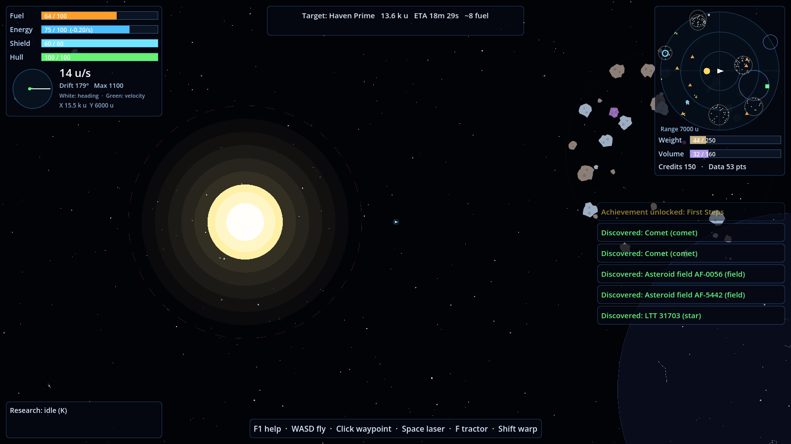
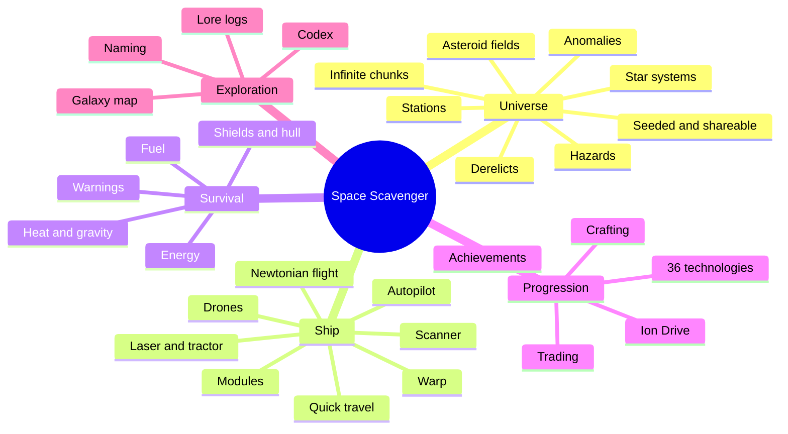
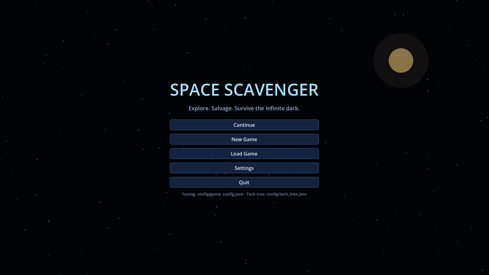
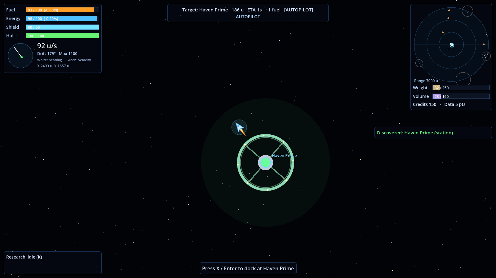
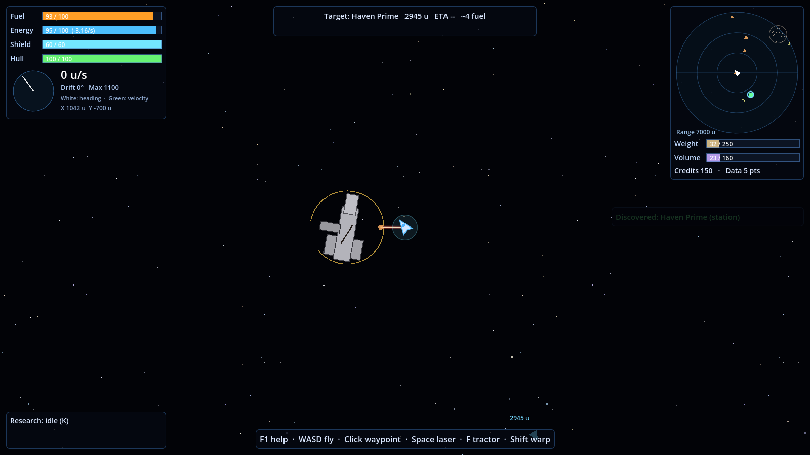
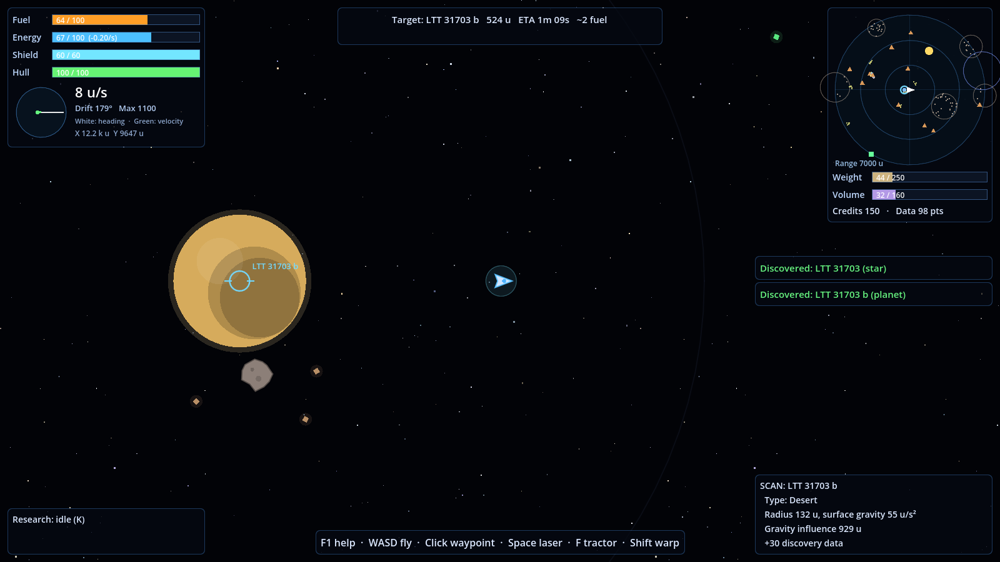
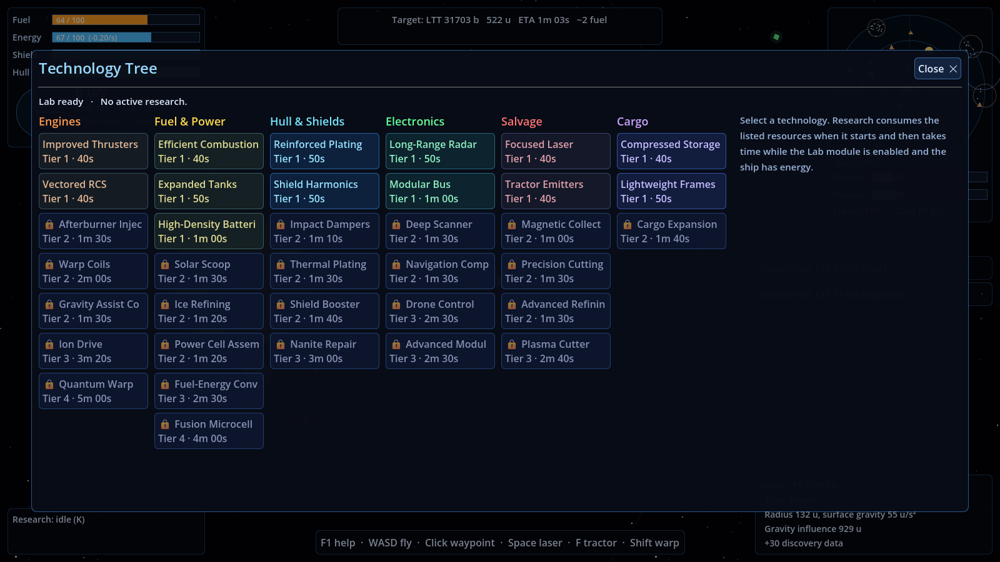
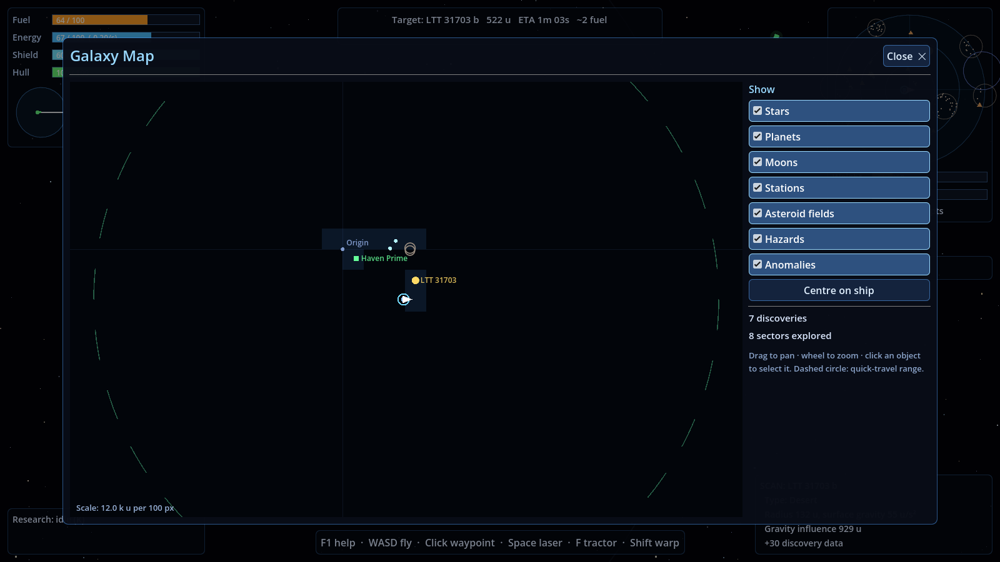
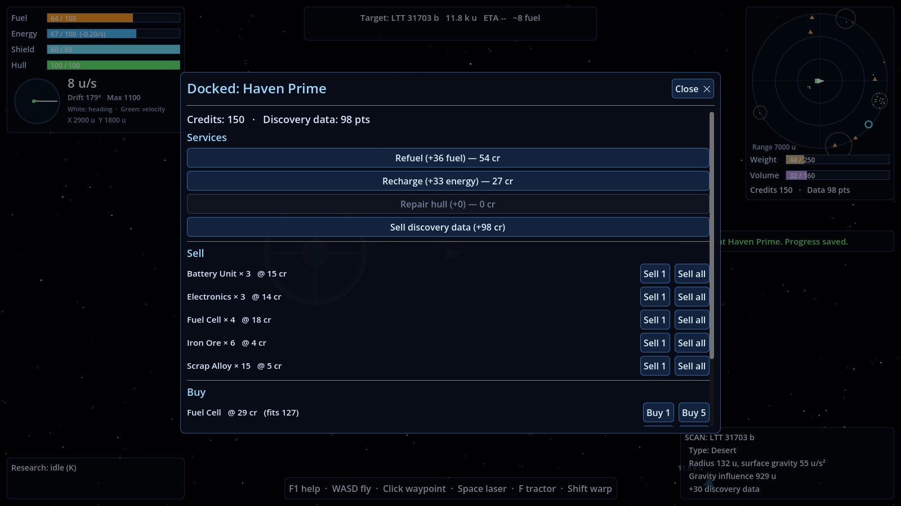
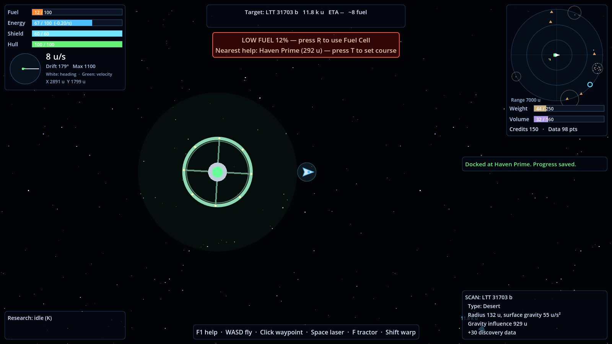

# Space Scavenger — Documentation

2D top-down space survival and exploration in an infinite procedural universe. Godot 4.7, GDScript only.

## Start here

| Document | For | Contents |
|---|---|---|
| [GAMEPLAY.md](GAMEPLAY.md) | Players, testers | HUD, flying, scavenging, survival, stations, crafting, research, codex, difficulty, saving |
| [GAME_FLOW.md](GAME_FLOW.md) | Designers | Application states, core loop, resource economy, navigation, discovery and naming, salvage, warnings, research, docking, hazards |
| [ARCHITECTURE.md](ARCHITECTURE.md) | Developers | Components, scene tree, floating origin, procedural generation, threaded streaming, entity model, stats pipeline, frame order, delta saves, UI, extension points |
| [CONFIGURATION.md](CONFIGURATION.md) | Designers, developers | **How to tweak values**: the two tuning files, reload workflow, mods, every config section, ship stats, tech format, tuning recipes |
| [CONFIG_REFERENCE.md](CONFIG_REFERENCE.md) | Designers | *Generated:* current values (ship stats, items, recipes, modules, loot, stars, planets, spawn chances, difficulty, economy, achievements, key bindings) |
| [TECH_TREE.md](TECH_TREE.md) | Designers, players | *Generated:* dependency graph and all 36 technologies with cost, time, prerequisites and effects |
| [REQUIREMENTS.md](REQUIREMENTS.md) | Everyone | Approved requirements (88) and the decisions log for the gap clarifications G1–G10 |
| [REQUIREMENTS_STATUS.md](REQUIREMENTS_STATUS.md) | Product owner, QA | Traceability: where each requirement is implemented and how it is verified, plus the manual check list |
| [DEVELOPMENT.md](DEVELOPMENT.md) | Developers | Environment, commands, tests, conventions, how-to recipes, exporting |
| [TODO.md](TODO.md) | Everyone | Deferred features (co-op, base building, factions, 3D, distress beacon, enemies) and later ideas |

## The two files to tweak

| File | What to change there |
|---|---|
| [`config/game_config.json`](../config/game_config.json) | Limits, rates, prices, costs, spawn chances, items, loot, recipes, modules, difficulty, warnings, achievements, colours, key bindings |
| [`config/tech_tree.json`](../config/tech_tree.json) | Every technology: branch, tier, cost, time, prerequisites, effects, unlocks |

Press **F6** in game to reload them. Run `python tools/gen_docs.py` afterwards to refresh the generated docs.

## At a glance

## Screenshots

| | |
|---|---|
|  |  |
|  |  |
|  |  |
|  |  |
