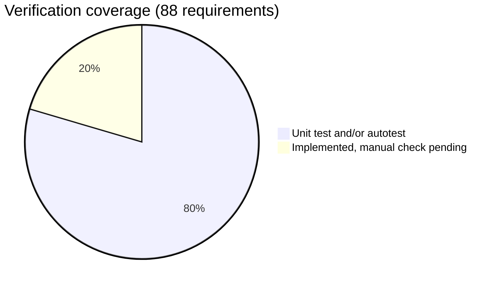

# Requirements Traceability

Status of every requirement in [REQUIREMENTS.md](REQUIREMENTS.md) as of build 1 (2026-10-16).

**Verification legend**
- **UT**: covered by the headless unit tests (`tests/tests.gd`, 265 checks).
- **AT**: exercised by the scripted play session (`--autotest`) and checked on its screenshots.
- **Impl**: implemented, but not yet exercised by an automated test. Needs a manual play check.

All 88 requirements are implemented. Items deliberately out of scope are listed in [TODO.md](TODO.md).

## Configuration (CFG)
| ID | Requirement | Implementation | Verified |
|---|---|---|---|
| CFG-01 | All tunables in one file | `config/game_config.json`, read through `Config` (`config.gd`) | UT |
| CFG-02 | All tech nodes in one file | `config/tech_tree.json` | UT (integrity checks) |
| CFG-03 | Mod overrides deep-merged | `Config.reload()` → `deep_merge`, `_merge_tech` | Impl |
| CFG-04 | Input bindings in config | `input_bindings` → `Config.apply_input_bindings()` | UT |

## Camera (CAM)
| ID | Requirement | Implementation | Verified |
|---|---|---|---|
| CAM-01 | Top-down, ship-centred | `camera_rig.gd` | AT |
| CAM-02 | Smooth dynamic zoom | `camera_rig.zoom_by`, `camera.zoom_*` config | AT |
| CAM-03 | Inertial follow with velocity lead | `camera_rig._process` look-ahead | AT |
| CAM-04 | Photo mode | `main._set_photo_mode`, camera free pan | AT |

## Navigation & universe (NAV)
| ID | Requirement | Implementation | Verified |
|---|---|---|---|
| NAV-01 | Infinite procedural universe | `generator.gd` chunks + systems | UT (far chunk) / AT |
| NAV-02 | Chunk load/unload | `universe._update_streaming`, `_unload_group` | AT (warp stream) |
| NAV-03 | Deterministic seeds | `Generator.hash3`, seeded RNG | UT |
| NAV-04 | Floating origin | `universe.shift_origin`, 64-bit `Game.origin_*` | UT (large coords in save) / AT |
| NAV-05 | Newtonian-lite flight | `ship._flight` | AT |
| NAV-06 | WASD + Q/E manual control | `ship._flight`, bindings | AT (thrust) |
| NAV-07 | Click waypoint/target + autopilot | `main._set_waypoint_at_mouse`, `ship._autopilot_input` | AT (autopilot) |
| NAV-08 | Thrust uses fuel (energy with Ion Drive) | `ship._consume_propellant` | UT (engine mode) / AT |
| NAV-09 | Standard flight mode | `ship._flight` (no warp) | AT |
| NAV-10 | Warp: fast, costly, tools off | `ship.warp`, `tools_allowed()` | AT |
| NAV-11 | Gravity sphere of influence | `universe.gravity_at` | AT |
| NAV-12 | Gravity assist efficiency | `gravity_assist_efficiency` × `last_well_depth` | Impl |
| NAV-13 | Navigate to discovered object | Codex / Map "Set as target" → `main.set_target_entry` | Impl |
| NAV-14 | Quick travel with cost and range | `ship.quick_travel*` | Impl |
| NAV-15 | Distance, ETA, fuel estimate | HUD target panel, `ship.estimate_trip_fuel` | AT |

## World (WLD)
| ID | Requirement | Implementation | Verified |
|---|---|---|---|
| WLD-01 | Star thermal zone | `star.gd`, `ship._environment` heat | AT (zone drawn) |
| WLD-02 | Solar scoop energy | `scoop_rate`, Solar Scoop module | Impl |
| WLD-03 | Planets and moons with gravity | `planet.gd` | AT |
| WLD-04 | Low-orbit derelicts and scrap | `Generator.system_at` debris band | AT |
| WLD-05 | Minable asteroid fields | `asteroid.gd`, field marker | AT |
| WLD-06 | Iron / titanium / rare ore | `loot.asteroid_*` | UT (loot items) / AT |
| WLD-07 | Derelict salvage | `derelict.gd`, `loot.derelict_*` | AT |
| WLD-08 | Black holes, nebulae, ion storms, flares, comets | `black_hole.gd`, `nebula.gd`, `ion_storm.gd`, `star.gd`, `asteroid.gd` (comet) | Impl (comet seen in AT) |
| WLD-09 | Wormholes, signals, ghost ships, rescue | `wormhole.gd`, `beacon.gd`, `derelict.gd` | Impl |
| WLD-10 | Trading stations | `station.gd`, `StationWindow` | AT |
| WLD-11 | Biomes and richness | `Generator.biome`, `richness` | Impl |
| WLD-12 | Derelict lore logs | `Naming.lore_entry`, `Game.add_log` | AT (log toast) |

## Resources (RES)
| ID | Requirement | Implementation | Verified |
|---|---|---|---|
| RES-01 | Fuel cells refuel | `items.fuel_cell.use`, `Game.use_item` | Impl |
| RES-02 | Energy powers systems | `ship._systems`, `_tools` | AT |
| RES-03 | Scrap/minerals for repair, craft, research | items `use`, recipes, tech costs | UT |
| RES-04 | Short-range tractor | `ship._tools` | AT |
| RES-05 | Salvage laser | `ship._tools`, `universe.raycast` | AT |
| RES-06 | Proximity collection (small) | `ship._collect` | AT |
| RES-07 | Weight + volume limits | `Game.space_for`, `cargo_limit_reason` | UT |
| RES-08 | Refining / crafting | `Game.craft`, `CargoWindow` | UT / AT (window) |
| RES-09 | Jettison | `main.jettison`, pickup `cooldown` | Impl |
| RES-10 | Collector drones | `drone.gd`, Drone Bay module | Impl |
| RES-11 | Deep scan + data | `ship.start_scan`, `scan_info()` | AT |

## Ship systems (SHP)
| ID | Requirement | Implementation | Verified |
|---|---|---|---|
| SHP-01 | Fuel burn while thrusting | `ship._flight` | AT (rate shown) |
| SHP-02 | Background energy drain | `ship._systems` | AT |
| SHP-03 | RCS-only drift without fuel | `ship._flight` (no propellant branch) | Impl |
| SHP-04 | Shields absorb and regenerate | `ship.apply_damage`, `_systems` | AT |
| SHP-05 | Hull damage after shields | `ship.apply_damage` | AT |
| SHP-06 | Destruction → reload / Ironman end | `main._on_ship_destroyed`, `_reload_after_death` | AT (reload); Ironman Impl |
| SHP-07 | Module slots | `Game.install_module`, `ModulesWindow` | UT |
| SHP-08 | Converter and Ion Drive | `fuel_converter` module, `eng_ion_drive` | UT (engine mode) |
| SHP-09 | Low-resource warnings + suggestion | `hud._update_warnings`, `_nearest_help`, key T | AT |
| SHP-10 | Repair with scrap | `items.scrap_alloy.use`, key H | Impl |

## HUD (HUD)
| ID | Requirement | Implementation | Verified |
|---|---|---|---|
| HUD-01 | Fuel/energy gauges + rates | `hud.Gauge` | AT |
| HUD-02 | Shield/hull gauges | `hud.Gauge` | AT |
| HUD-03 | Speed + vector arrow | `hud.VectorView` | AT |
| HUD-04 | Radar POIs | `radar.gd` | AT |
| HUD-05 | Cargo quick view | HUD right panel | AT |
| HUD-06 | Target panel + off-screen marker | `hud.TargetOverlay` | AT |
| HUD-07 | Galaxy map | `map_window.gd` | AT |
| HUD-08 | Codex / logbook | `CodexWindow` | AT |
| HUD-09 | Toasts + warning banner | `hud._on_toast`, warning panel | AT |
| HUD-10 | Help overlay | `HelpWindow` | AT |

## Naming (NAM)
| ID | Requirement | Implementation | Verified |
|---|---|---|---|
| NAM-01 | Name-or-random prompt on discovery | `NamingDialog`, `main.naming_queue` | Impl (disabled in autotest) |
| NAM-02 | Astronomical conventions | `naming.gd` | UT |
| NAM-03 | Rename from codex | `CodexWindow._rename` | Impl |

## Save & restore (SAV)
| ID | Requirement | Implementation | Verified |
|---|---|---|---|
| SAV-01 | Full save/restore | `Game.to_dict/from_dict` | UT / AT |
| SAV-02 | Delta saves | `Game.removed`, `names`, `discoveries` | UT |
| SAV-03 | Discovered objects list | Codex, Map | AT |
| SAV-04 | Slots + autosave | `SaveLoadWindow`, `main` autosave | AT (autosave on dock) |
| SAV-05 | Versioned, migratable | `SAVE_VERSION`, `Game.migrate` | Impl |

## Technology (TEC)
| ID | Requirement | Implementation | Verified |
|---|---|---|---|
| TEC-01 | Researched with resources | `Game.start_research` | UT |
| TEC-02 | Time + Lab required | `Game.process_research`, `lab_ready` | UT |
| TEC-03 | Six branches | `tech_tree.json` branches | AT (window) |
| TEC-04 | Stats and unlocks | `Game.recalc_stats`, `complete_research` | UT |
| TEC-05 | Single file | `tech_tree.json` | UT |

## Meta (META)
| ID | Requirement | Implementation | Verified |
|---|---|---|---|
| META-01 | Stats + achievements | `Game.stat_add`, `StatsWindow` | AT |
| META-02 | Difficulty presets | `difficulty` config, `Game.diff_cfg` | UT (relaxed save) |
| META-03 | Shareable seeds | Main menu seed field, pause menu shows the seed | AT |
| META-04 | Player settings | `SettingsWindow`, `user://settings.json` | Impl |

## Non-functional (NFR)
| ID | Requirement | Implementation | Verified |
|---|---|---|---|
| NFR-01 | 60 FPS while streaming | WorkerThreadPool generation, spawn budget | AT (min 59 FPS at warp) |
| NFR-02 | No jitter far away | Floating origin | UT / AT |
| NFR-03 | Keyboard, mouse and basic gamepad | `input_bindings` (`JoyButton`/`JoyAxis`) | Impl (no gamepad tested) |
| NFR-04 | Automated tests | `tests/`, `--autotest` | UT |
| NFR-05 | Godot 4, GDScript only | Godot 4.7.2 | UT |

## Manual check list (Impl items)

Play through these at least once before release:

1. Fly into a nebula and an ion storm, approach a black hole, ride a wormhole, collect a signal, and complete a rescue.
2. Research Solar Scoop, Fuel Converter, Ion Drive and Drone Bay, then use each.
3. Run out of fuel and maneuver on RCS; refuel with R; repair with H.
4. Jettison cargo and confirm it is not re-collected immediately.
5. Quick-travel from the codex and the map; check the range and cost messages.
6. Name a body from the discovery prompt and rename it in the codex. Check that the default names of its planets and moons follow.
7. Play an Ironman run to destruction and confirm the save is deleted.
8. Change UI scale, colour-blind palette, game speed and fullscreen; restart and confirm they persist.
9. Add `user://mods/game_config.json` with `{"ship": {"thrust": 600}}` and confirm it applies.
10. Connect a gamepad and fly.
