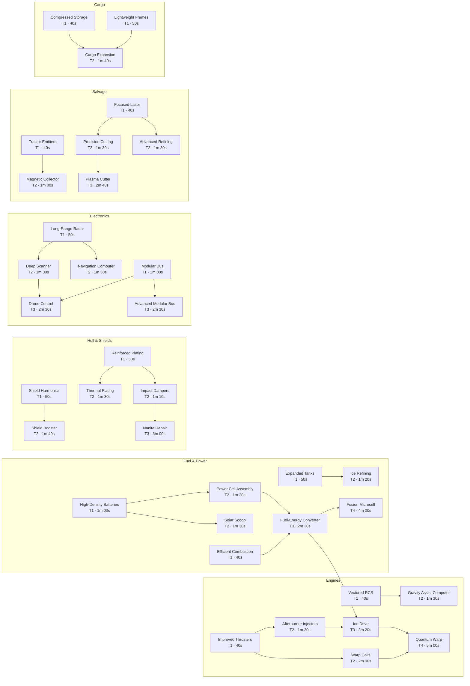

<!-- Generated by tools/gen_docs.py from the config files. Do not edit by hand. -->

# Technology Tree

Source: [`config/tech_tree.json`](../config/tech_tree.json). Every node lives in that one file; edit it to rebalance costs, times, prerequisites and effects, then run `python tools/gen_docs.py`.

## How research works

1. The **Research Lab** module must be installed **and** enabled (Modules window, `U`).
2. Prerequisites (`requires`) must be researched first.
3. The `cost` items are taken from cargo when research **starts**.
4. Research takes `time` seconds of game time. It pauses while the Lab is disabled or the ship has no energy, and the Lab draws extra energy while it runs (`modules.lab.research_energy_per_sec`).
5. Cancelling refunds 50% of the cost.
6. On completion, `effects` modify ship stats, `unlocks` make modules or recipes available, and `sets` changes global flags (the Ion Drive switches `engine_mode` to `energy`).

**36 technologies** in **6 branches**; researching everything takes 57m 50s of lab time.

## Dependency graph

## Engines

| Technology | Tier | Cost | Time | Requires | Effects |
|---|---|---|---|---|---|
| **Improved Thrusters** `eng_thrusters_1` | 1 | 8 Scrap Alloy, 10 Iron Ore | 40s | - | `thrust` ×1.15 |
| **Vectored RCS** `eng_rcs` | 1 | 6 Scrap Alloy, 2 Electronics | 40s | - | `rcs_thrust` +40 `rotation_speed` ×1.2 |
| **Afterburner Injectors** `eng_thrusters_2` | 2 | 4 Alloy Plate, 6 Titanium Ore | 1m 30s | Improved Thrusters | `thrust` ×1.2 `max_speed` ×1.15 |
| **Gravity Assist Computer** `eng_gravity_assist` | 2 | 5 Electronics, 4 Titanium Ore | 1m 30s | Vectored RCS | `gravity_assist_efficiency` +0.5 |
| **Warp Coils** `eng_warp_coils` | 2 | 3 Titanium Plate, 4 Electronics | 2m 00s | Improved Thrusters | `warp_max_speed` ×1.35 `warp_fuel_burn_per_sec` ×0.8 |
| **Ion Drive** `eng_ion_drive` | 3 | 3 Circuit Board, 4 Titanium Plate, 4 Rare Ore | 3m 20s | Afterburner Injectors, Fuel-Energy Converter | `thrust` ×1.1 Sets `engine_mode` = `energy` |
| **Quantum Warp** `eng_quantum_warp` | 4 | 2 Data Core, 4 Circuit Board | 5m 00s | Warp Coils, Ion Drive | `warp_max_speed` ×1.5 `quick_travel_max_distance` ×2.0 |

## Fuel & Power

| Technology | Tier | Cost | Time | Requires | Effects |
|---|---|---|---|---|---|
| **Efficient Combustion** `pow_combustion` | 1 | 8 Iron Ore, 2 Electronics | 40s | - | `fuel_burn_per_sec` ×0.85 `warp_fuel_burn_per_sec` ×0.9 |
| **Expanded Tanks** `pow_tanks` | 1 | 12 Iron Ore, 6 Scrap Alloy | 50s | - | `fuel_capacity` +40 |
| **High-Density Batteries** `pow_batteries` | 1 | 4 Electronics, 4 Titanium Ore | 1m 00s | - | `energy_capacity` +50 |
| **Ice Refining** `pow_ice_refining` | 2 | 3 Alloy Plate | 1m 20s | Expanded Tanks | Unlocks recipe **Fuel Cell from Ice** |
| **Power Cell Assembly** `pow_power_cells` | 2 | 6 Electronics | 1m 20s | High-Density Batteries | Unlocks recipe **Battery Unit** |
| **Solar Scoop** `pow_solar_scoop` | 2 | 2 Titanium Plate, 4 Electronics | 1m 30s | High-Density Batteries | Unlocks module **Solar Scoop** |
| **Fuel-Energy Converter** `pow_converter` | 3 | 2 Circuit Board, 4 Alloy Plate | 2m 30s | Efficient Combustion, Power Cell Assembly | Unlocks module **Fuel Converter** |
| **Fusion Microcell** `pow_fusion` | 4 | 1 Data Core, 3 Circuit Board, 5 Rare Ore | 4m 00s | Fuel-Energy Converter | `life_support_drain` ×0.5 `sensor_drain` ×0.5 `energy_capacity` +80 |

## Hull & Shields

| Technology | Tier | Cost | Time | Requires | Effects |
|---|---|---|---|---|---|
| **Reinforced Plating** `hul_plating` | 1 | 15 Iron Ore, 6 Scrap Alloy | 50s | - | `hull_max` +40 |
| **Shield Harmonics** `hul_shield_1` | 1 | 3 Electronics, 5 Titanium Ore | 50s | - | `shield_max` +30 `shield_regen_per_sec` ×1.25 |
| **Impact Dampers** `hul_dampers` | 2 | 3 Alloy Plate | 1m 10s | Reinforced Plating | `collision_damage_factor` ×0.6 |
| **Shield Booster** `hul_shield_2` | 2 | 5 Electronics, 2 Titanium Plate | 1m 40s | Shield Harmonics | Unlocks module **Shield Booster** |
| **Thermal Plating** `hul_thermal` | 2 | 3 Titanium Plate | 1m 30s | Reinforced Plating | `heat_resistance` +0.25 Unlocks module **Heat Shield** |
| **Nanite Repair** `hul_nanites` | 3 | 3 Circuit Board, 3 Rare Ore | 3m 00s | Impact Dampers | `hull_regen_per_sec` +0.25 |

## Electronics

| Technology | Tier | Cost | Time | Requires | Effects |
|---|---|---|---|---|---|
| **Long-Range Radar** `ele_radar` | 1 | 4 Electronics, 4 Scrap Alloy | 50s | - | `radar_range` ×1.4 |
| **Modular Bus** `ele_bus_1` | 1 | 3 Electronics, 2 Alloy Plate | 1m 00s | - | `module_slots` +1 |
| **Deep Scanner** `ele_scanner` | 2 | 6 Electronics, 4 Titanium Ore | 1m 30s | Long-Range Radar | `scan_range` ×1.25 Unlocks module **Deep Scanner** |
| **Navigation Computer** `ele_navcomp` | 2 | 5 Electronics, 2 Alloy Plate | 1m 30s | Long-Range Radar | `quick_travel_max_distance` ×1.5 `quick_travel_fuel_per_1000` ×0.7 |
| **Advanced Modular Bus** `ele_bus_2` | 3 | 2 Circuit Board, 2 Titanium Plate | 2m 30s | Modular Bus | `module_slots` +1 |
| **Drone Control** `ele_drones` | 3 | 2 Circuit Board, 3 Titanium Plate | 2m 30s | Modular Bus, Deep Scanner | Unlocks module **Drone Bay** |

## Salvage

| Technology | Tier | Cost | Time | Requires | Effects |
|---|---|---|---|---|---|
| **Focused Laser** `sal_laser_1` | 1 | 6 Iron Ore, 2 Electronics | 40s | - | `laser_dps` ×1.4 |
| **Tractor Emitters** `sal_tractor` | 1 | 3 Electronics, 6 Iron Ore | 40s | - | `tractor_range` ×1.3 `tractor_strength` ×1.3 |
| **Advanced Refining** `sal_advanced_refining` | 2 | 3 Alloy Plate, 2 Rare Ore | 1m 30s | Focused Laser | Unlocks recipe **Circuit Board** |
| **Magnetic Collector** `sal_magnet` | 2 | 6 Titanium Ore | 1m 00s | Tractor Emitters | `proximity_range` ×1.6 |
| **Precision Cutting** `sal_precision` | 2 | 2 Titanium Plate, 3 Electronics | 1m 30s | Focused Laser | `salvage_yield` ×1.3 |
| **Plasma Cutter** `sal_laser_2` | 3 | 2 Circuit Board, 3 Rare Ore | 2m 40s | Precision Cutting | `laser_dps` ×1.6 `laser_range` ×1.25 `laser_energy_per_sec` ×0.8 |

## Cargo

| Technology | Tier | Cost | Time | Requires | Effects |
|---|---|---|---|---|---|
| **Compressed Storage** `car_storage` | 1 | 8 Scrap Alloy, 8 Iron Ore | 40s | - | `cargo_max_volume` ×1.3 |
| **Lightweight Frames** `car_frames` | 1 | 6 Titanium Ore | 50s | - | `cargo_max_weight` ×1.3 |
| **Cargo Expansion** `car_expander` | 2 | 4 Alloy Plate, 2 Titanium Plate | 1m 40s | Compressed Storage, Lightweight Frames | Unlocks module **Cargo Expander** Unlocks module **Auxiliary Fuel Tank** |

## Total resources to research everything

| Item | Total |
|---|---|
| Iron Ore | 65 |
| Electronics | 61 |
| Scrap Alloy | 38 |
| Titanium Ore | 35 |
| Alloy Plate | 25 |
| Titanium Plate | 23 |
| Circuit Board | 21 |
| Rare Ore | 17 |
| Data Core | 3 |
